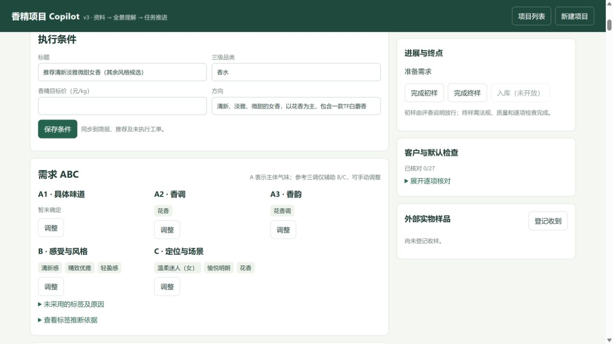

# V3注解版问题核查与本轮修正（2026-10-30）

核查对象：`../fragrance-copilot-v3-注解版/注解/11_已知设计与坑.md`。注解版来自07:27的代码快照，不能直接覆盖持续开发的V3。本轮修改均合入正在运行的 `fragrance-copilot-v3`。

## 计分方向：以用户本轮纠正为准

第二轮是 **需求C → 需求C直接关联的AB并集 → 匹配候选自身已有A/B**，每个distinct AB命中加1；多个需求C关联到相同AB只计一次，明细保留全部来源需求C。不从候选C反推AB，也不把未选择子C的关联自动扩进需求。

第一轮直接A/B/C仍按1/1/3；硬筛标签本身不计直接分。第二轮独立于直接分。两类推荐共用规则。`mapped_hits.via_demand_cs`、算法版本及缓存签名已更新。旧推荐快照留存，当前条件重新计算，保留短名单、淘汰和已选内部号。

注解文档称反方向是“V3特意修正”，这是对当时代码的描述，不能据此当成正确业务设计；本轮用户已明确纠正。当前README、计分文档、界面和回归例均同步修订。历史V2资料和注解快照保留原状供对照。

## 已采纳并落地

| 观察 | 修改 |
|---|---|
| 默认硬筛有前后端两份 | 恢复默认通过后端 `reset_filters`，只调用 `reco.default_filters`，删除前端手抄策略 |
| 多目标产品版本诊断受先前命中干扰 | 每个目标独立统计命中，不再使用共享found判断当前版本是否验证 |
| manual_keys依赖短路作用域 | 在分支外初始化，消除新建分支的潜在未赋值隐患 |
| QA文件是死提示词 | 更新 `prompts/qa.md` 为V3全文上下文契约，接口直接读取该文件 |
| 缺少稳定日志 | 添加 `data/copilot.log`，单文件2MB、保留3个轮换文件；服务启动和未处理接口异常落日志 |
| 启动脚本混用行尾、固定端口 | 统一CRLF，浏览器和健康检查跟随V3_PORT；用禁止真实启动/网络/等待的副本干跑确认无cmd解析错误 |
| 上传造成大块内存分配 | JSON请求先检查72MB上限；50MB文件编码长度在解码前检查，异常输入类型及非法编码统一给400和明确原因 |
| 创建操作审计不全 | 增补项目创建、资料创建、实物样品登记审计，记录对象及来源元数据，不重复保存原文 |
| 共享交付可能被局部组合说明掩盖 | 工单增加project_delivery和明确标为“项目总体”的供样约定；局部数量保持局部，已done工单不改写 |
| C标签被剔除不易查看 | ABC卡片增加未采用标签及原因、未映射域的说明 |

## 小推暴露的问题及处理

1. 全空ABC通过了空集合校验。现增加语义完成度检查；必要时同节点最多一次合批映射复核。仍未映射的品牌语义推荐不返回全库零分榜。
2. 单一初始需求的项目普通简报与子简报断开。允许单一分支继承其整体普通事实；多分支项目不广播汇总气味，仍按shared/local作用域处理。
3. target_products已提取却没找香入口。对推荐任务中已结构化明确的具体产品建立并行找香入口；不用原文关键词决定分类，也不从普通参考列表自动制造必选产品。稳定身份和库内产品别名用于避免重复创建。
4. 组合总量与单项数量分开保存；指定款属于5～7款总组合。18%加香小样、不要寄香精随项目总体约定进入未执行工单，未来可能的人宠/个护用途不自动变成当前产品或已验证宣称。
5. 搜索支持品牌缩写及库内双语产品身份：TF、Tom Ford、汤姆福特可对齐；White Suede／白麝香关系来自现有库内标注，不修改库。TF白麝香能命中JKP1745AJK、SYP1025ASY、SYP2552ASY。模糊浏览和具体产品身份匹配保持区分，近似参考不升级成精确身份，版本数字不做子串冒认。
6. 找香页面改为产品身份候选表，不显示无意义的ABC零分。风格选型才展示语义ABC计分。

## 核查后未照搬的建议

- **坏base64原来会500**：此观察不成立。Python的binascii.Error继承ValueError，原路由已转400。本轮改善的是明确文案、参数类型和解码前体积检查，有HTTP回归验证。
- **小项目2万字符与6000冲突**：当前主项目文档已是6000，注解副本信息部分过时。
- **恢复heuristic兜底**：不采纳。用户要求语义理解；模型失败不能无声换成关键词规则并伪装成功。
- **MAX_CONTEXT_CHARS就是模型容量**：确实不能等同。但模型窗口取决于实际供应商/模型，不能根据“多数模型”任意定统一窗口。保留不截断原文与明确失败；本轮不盲增阈值或强制拆资料。
- **已完成工单不刷新、类型纠正执行锁、项目字段唯一入口、有目标价时排除未知价、引用校验与指纹防覆盖**：保留。这些是业务一致性约束，不作为缺陷移除。
- **死代码/旧spec**：不批量删除，不将旧计分政策重新接回运行路径。QA文件已单独消除双口径。配置端口以V3_PORT为准。
- **无外键、硬删除、UTC迁移、多用户鉴权/部署、大文件流式读写、拆server/validate/前端组件**：观察有价值，但需要单独的数据迁移与兼容性设计；本轮保持现有数据结构，不大拆运行架构。尚未实现软删除/回收站或完整全写路径审计。

## 验证范围

隔离数据库回归覆盖原流程、正反计分方向反例、关联AB去重、旧缓存更新且决定保留、TF中英别名、版本不误认、空映射拦截、一次复核、单分支字段承袭与多分支防串、默认筛选恢复、坏上传及超大请求、QA提示词真实入口、创建审计、项目交付下传与已完成快照不变。

另进行启动脚本干跑、实际8768接口/页面复查、活动子项目重新计分和小推原文复跑。8张基础库表与V2逐表比对不变。实际结果与模型耗时另保存在 `data/verification/xiaotui_20261030/` 和本轮验证文件中。结构测试不等于所有业务推断已获客户确认。

## 标签身份与业务复核补充

页面复查发现模型曾用“轻盈感”的解释搭配B3_e826d4f21c；真实词表中这个ID是“厚重感”，轻盈感应是B3_737716d14f。这是“ID存在”校验无法发现的语义身份错配，已修正实际小推记录并留codex_review审计。

新生成必须为每条依据提供label+id；服务按模型已经明确选择的名称查权威词表核对编号，唯一名称可机械校正ID并留痕，重名且不能定位时有界复核/拒绝，不猜。C保持品类隔离。这里校验的是模型的选词与编号，不是从客户原文做关键词映射。模型的语义选择仍需来源支持；名称编号一致也不等于客户已确认。

小推另剔除了“微甜→活泼甜美”“未指定花种→单一花香”的过细推断，保留花香主体、清新/优雅/轻盈风格及有依据的C定位。原模型输出与修改前快照保留，系统复核不标成客户确认，评香任务仍待执行。实际基质未知留空；项目级未来用途意向和组合总供样约定保留。

最终隔离回归：**103项通过**（含身份错配校正、C重名不猜、新生成必带名称编号）。38个活动子项目的计分缓存已按新方向更新；这不代表对所有历史项目重新做了语义验收。4种TF白麝香查询实际HTTP均返回同3条记录，约290–307ms。8张基础库表与V2比对仍一致。基础库、历史完成工单、旧推荐与原件不改写。

### 最终真实模型复跑

run：g_7da60505b944480c。DeepSeek-V4-Pro、thinking关闭，一次调用29.47秒、4541输出tokens，finish_reason=stop；未触发映射或依据修复。返回全部8条ABC依据的名称与真实ID逐项一致。当前风格候选B显示清新感、精致优雅、轻盈感；不含误配的厚重感。A2花香、A3花香调，A1因未指定具体花种而留空；C为温柔迷人（女）、愉悦明朗、花香。TF找香按身份查询，不使用ABC计分。

小推实际候选总量：风格初筛2313条（界面显示前100，待评香选4～6款），TF对应3个内部候选（指定产品选1款），组合供样总数仍为5～7款，18%加香小样、不寄香精。具体内部候选与价目仍由评香确认，不自动视为已选/已寄或客户确认。

最终快照及计分集合核对：`data/verification/xiaotui_20261030/final_verification.json`。页面实拍：

