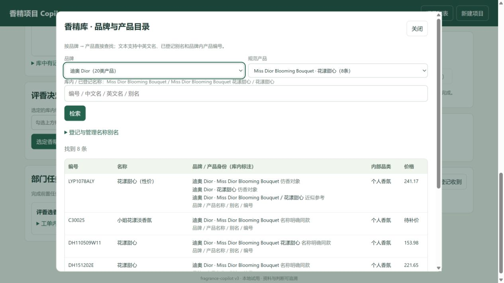

# 通用名称别名与小推2复测（2026-10-30）

## 根因

库里已有品牌、产品与内部香精号的结构关系；小推2也已提取为Le Labo+13、Le Labo+33。此前为了防止数字子串误命中，匹配器只接受完整产品名，把正常的品牌内简称也拒绝了。不是库中没有13/33，也不需要模型再次猜香水名称。

## 通用实现

统一解析链：品牌 → 规范产品 / 版本 → 库内名称与已确认别名 → 对应内部编号 → 品类 / 价格可用性。支持各种名称，不局限数字系列：

- 库内明确身份标签里的中英文名，可识别双语斜杠、空格、括号格式；归一大小写、空格、重音、常见标点与and/&写法。
- 简称、俗称、旧名、另一种译名等可在香精库界面“登记与管理名称别名”补充，按品牌及规范产品隔离；品牌别名也可登记。它们保存在应用层identity_aliases，有增删审计，不修改原始库表。
- 数字是其中一种适配：先确定品牌，再要求完整编号只对应一个目录产品；13不会靠子串碰到113，无品牌不擅自推断Another 13。编号冲突与其它重名一律列候选，需确认规范产品。
- 版本不自动省略。EDT/EDP、浓香精、浓度、容量等不当作中英文同名关系；未知版本不默认找其它版。小数/版号分隔不会被直接归为纯数字。
- 目录只采纳明确同款、同款指认、仿香对象等身份依据。仅近似/风格/母方参考不成为精确产品归属。未知别名可登记确认，不声称已掌握世界上所有香水的所有俗称。

## 界面与接口

香精库增加品牌和规范产品下拉选择、名称别名展示及应用别名管理，仍支持直接文本查询。找香显示原始叫法如何解析成规范产品，并分开显示“库内身份记录数”和“当前品类/价格条件下可用数”。有货号但不适用品类、超当前价或价格待确认，不再报告成库中没有。歧义产品可在找香页确认后保存。

新增GET /api/library/catalog、GET/POST /api/library/aliases、DELETE /api/library/aliases/{id}。原有库搜索支持brand/product结构参数。目录与所有项目找香共用同一解析器；别名变化自动使旧匹配缓存失效。原始客户叫法保留，解析结果另存于推荐快照。

## 实际复测

| 请求 | 规范身份 | 库内记录 |
|---|---|---:|
| Le Labo 13 | Another 13 / 别样13 | 6 |
| Le Labo 33 | Santal 33 / 檀香33 | 11 |
| 祖玛珑 鼠尾草与海盐 / Wood Sage and Sea Salt | Wood Sage & Sea Salt | 7 |
| 迪奥 花漾甜心 / Miss Dior Blooming Bouquet | Miss Dior Blooming Bouquet | 8 |

小推2沿用当前品类和价格配置：13有JKP864AJK（191.09元/kg）可用；33有LJC2344ALJ（176.24）、LYA1477CLY（228.71）、LJB872BLJB（293.01）可用。其它同产品记录按适用品类及价格分别列出原因，不表示已选、已寄或全部版本已验证。未改用户现有价格弹性设置。

此次实际查库约0.3～0.4秒/次，两个找香结果刷新约260/295ms，新增模型调用0次。没有重新生成项目，也没有自动发GC/调香工单。

115项隔离回归通过，包括非数字名、译名、重音/空格/连词、任意人工别名、品牌别名、多产品重名、版本不误认、编号不子串/不跨品牌、目录API、身份存在但筛选排除、别名变更缓存失效及审计。8张原始库表与V2比对不变。HTTP证据保存在data/verification/product_aliases_20261030/verification.json。

## 复用旧资料与配置边界

复用了ABC体系_20261028/scripts/brand_names.py中的82组已有品牌名称归一映射，保存为本项目spec/brand_name_aliases.json，运行时不依赖外部脚本。包括Jo Malone / Jo Malone London，以及Le Labo / 香水实验室 / 勒莱柏等已存在名称。只是品牌身份归一，不拿香材/风格去预测品牌。应用层新增别名可跨项目复用；品牌别名冲突会拒绝配置，避免把不同品牌合并。

已核对library_items.brand_labels_json内所有非空产品身份均存在于formula_product_labels，没有遗漏另一份已有结构标签。正名优先于品牌前缀拆分，避免把产品名本身含品牌词时错误截断。目录与查询的异步结果也有版本检查，避免快速切换品牌/产品后被旧响应覆盖。

界面复核：小推2的13号页显示13 → Another 13、6条身份记录、当前可用1条；目录选择Le Labo → Another 13 / 别样13后确实返回6条，并显示对应中文/英文名称。非编号产品“花漾甜心”“鼠尾草与海盐”同样走通用目录解析。

### 最终界面核查

已实查品牌目录选中“迪奥 Dior → Miss Dior Blooming Bouquet / 花漾甜心”，返回8条库内记录，展示中英文名称与原始身份关系。可视证据如下：

找香页面另补齐品类/价格筛选和价格弹性控制（0即严格按目标价），避免有筛选但用户没有调整入口。本次保留小推2已有弹性设置；库内身份记录与当前可用记录分别显示。
